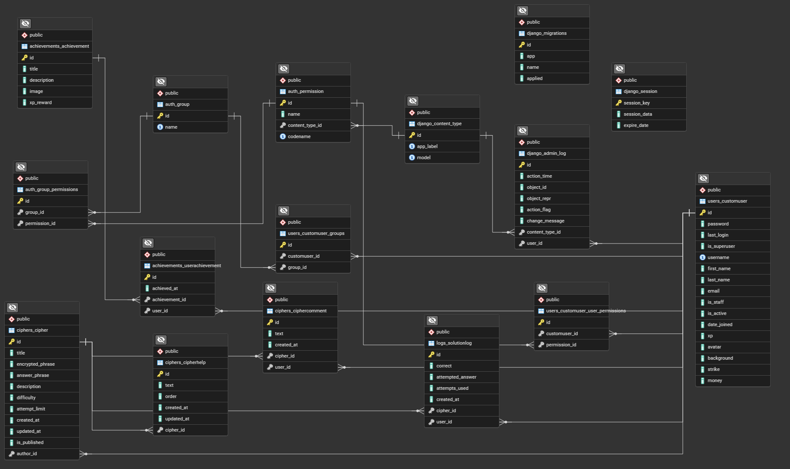

# Cryptonite — платформа для изучения шифров

[](https://gitlab.crja72.ru/django/2025/autumn/course/projects/team-1/-/pipelines)
## ⚙️ Требования

Перед запуском проекта убедитесь, что у вас установлена необходимая версия Python: **3.10, 3.11, 3.12 или 3.13**, **git и gettext** 


## 👾 Описание проекта

Cryptonite — это платформа, посвящённая шифрам, их решению и взаимодействию пользователей внутри сообщества. Ниже приведено описание функциональности проекта и разграничения ролей.

---

## Роли пользователей

В системе реализованы четыре основные роли:

### 1. Анонимный пользователь (`is_authenticated=False`)
- Не может ставить лайки  
- Не имеет доступа к страницам решений шифров  
- Не может просматривать профили других пользователей  
- Не может создавать шифры  

### 2. Обычный пользователь (`is_authenticated=True`)
- Имеет доступ ко всем базовым функциям платформы  
- Может ставить лайки, решать шифры, просматривать профили  
- Может редактировать данные своего профиля  
- Может создавать и редактировать собственные шифры  
- Может создавать курсы (функциональность реализована частично и не являлась приоритетной на текущем этапе)

### 3. Менеджер-модератор (`is_staff=True`)
- Может модерировать шифры пользователей  
- Может скрывать и публиковать шифры других участников  
- Имеет расширенные права для оперативного реагирования в критических ситуациях  

### 4. Главный администратор (`is_superuser=True`)
- Имеет полный доступ ко всем возможностям системы  

> **Примечание:** при создании новый шифр по умолчанию отправляется на модерацию, поэтому для полного тестирования рекомендуется создать несколько аккаунтов с разными ролями.

---

## Дополнительные возможности

- **QR-код для каждого шифра** — позволяет быстро перейти к шифру, например, с мобильного устройства  
- **Шифр дня**  
- **Лидерборд пользователей**

---

## 🚀 Запуск проекта в режиме разработки

Следуйте шагам ниже, чтобы развернуть проект локально.

---

### 1. Клонирование репозитория

Скачайте проект на локальную машину и перейдите в его директорию:

```bash
git clone https://gitlab.crja72.ru/django/2025/autumn/course/projects/team-1.git
cd team-1
```

---

### 2. Создание и активация виртуального окружения

Создаём виртуальное окружение для Python и активируем его:

| ОС                          | Команды                                                 |
| :---------------------------- | :------------------------------------------------------------- |
| **Windows ❖**          | ``python -m venv venv`` ` && ` ``venv/Scripts/activate``     |
| **macOS  / Linux 🐧** | ``python3 -m venv venv`` ` && ` ``source venv/bin/activate`` |

---

### 3. Установка зависимостей

Зависимости проекта разделены на несколько файлов.
Выберите нужный вариант в зависимости от окружения.

#### 🔧 Для разработки (`dev.txt`)
``pip install -r requirements/dev.txt``

#### 🧪 Для тестирования (`test.txt`)
``pip install -r requirements/test.txt``

#### 🚀 Для продакшена (`prod.txt`)
``pip install -r requirements/prod.txt``

---

### 4. Настройка переменных окружения

Создайте файл `.env` на основе шаблона:

| Среда                     | Команда                   |
| :----------------------------- | :------------------------------- |
| Linux / macOS / Git Bash / WSL | `cp .env.template .env`        |
| Windows (PowerShell)           | `Copy-Item .env.template .env` |
| Windows (CMD)                  | `copy .env.template .env`      |

Пример содержимого `.env`:

```env
# Django Settings
DJANGO_ALLOWED_HOSTS=localhost,127.0.0.1
DJANGO_DEBUG=True
DJANGO_SECRET_KEY=fake_insecure_key_for_template_!@
DJANGO_LANGUAGE_CODE=ru

# Database Settings
DJANGO_DB_NAME=demo_project_db
DJANGO_DB_USER=demo_user
DJANGO_DB_PASSWORD=demo_password_123ABC
DJANGO_DB_HOST=localhost
DJANGO_DB_PORT=5432
```

---

Перейдите в папку проекта:

```bash
cd cryptonite
```

### 5. Применение миграций и работа с базой данных

#### Выполните миграции

| ОС                | Команда                |
| :------------------ | :---------------------------- |
| Windows ❖          | `python manage.py migrate`  |
| macOS  / Linux 🐧 | `python3 manage.py migrate` |

#### Загрузка тестовых данных (фикстур)

Если проект содержит подготовленные фикстуры, загрузите их следующей командой:

| ОС        | Команда                                   |
| :---------- | :----------------------------------------------- |
| Все ОС | `python manage.py loaddata fixtures/data.json` |

*(Если файла фикстур нет, этот шаг можно пропустить.)*

---

### 6. Создание суперпользователя

Создайте администратора для доступа к админ-панели:

| ОС                | Команда                        |
| :------------------ | :------------------------------------ |
| Windows ❖          | `python manage.py createsuperuser`  |
| macOS  / Linux 🐧 | `python3 manage.py createsuperuser` |

После запуска сервера админка будет доступна по адресу:
👉 [http://127.0.0.1:8000/admin](http://127.0.0.1:8000/admin)

---

### 7. Локализация проекта

Выберите язык по умолчанию в файле `settings.py`:

```python
LANGUAGE_CODE = 'en'
```

Для генерации и компиляции переводов используйте:

| Действие                              | Команда                                                                 |
| :-------------------------------------------- | :----------------------------------------------------------------------------- |
| Создать файлы перевода    | `django-admin makemessages -l en` или `django-admin makemessages -l ru` |
| Скомпилировать переводы | `django-admin compilemessages`                                               |

---

### 8. Запуск сервера разработки

Теперь можно запустить проект:

| ОС                | Команда                  |
| :------------------ | :------------------------------ |
| Windows ❖          | `python manage.py runserver`  |
| macOS  / Linux 🐧 | `python3 manage.py runserver` |

После запуска проект будет доступен по адресу:
👉 [http://127.0.0.1:8000](http://127.0.0.1:8000)

---

## 🗄️ ER-диаграмма базы данных



> На диаграмме показана структура моделей проекта.
> Со временем база данных может расширяться, добавляться новые связи и таблицы.

---

© 2025 — Проект Criptonite, Яндекс Лицей.
